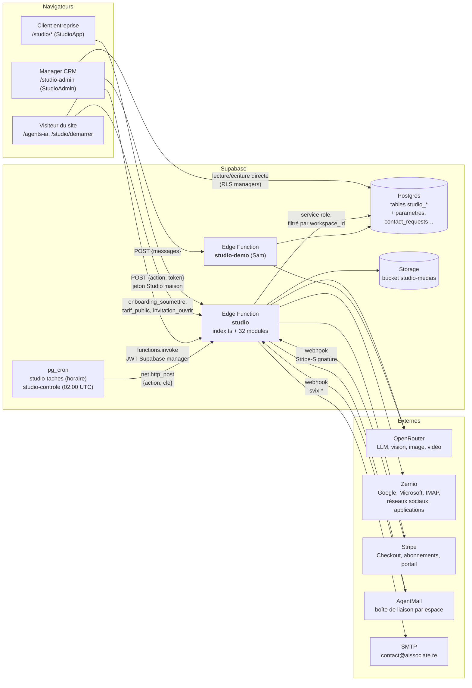
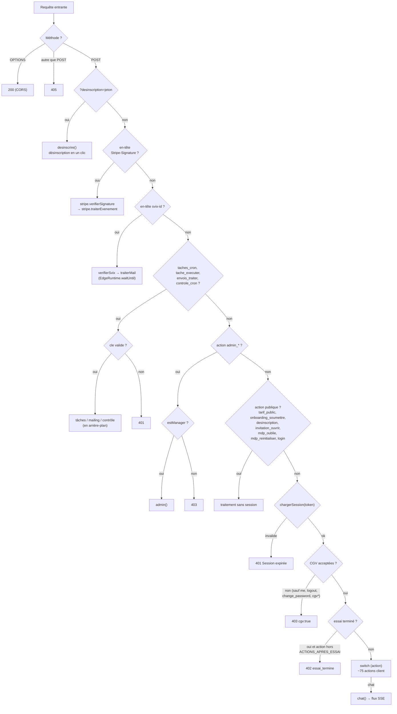
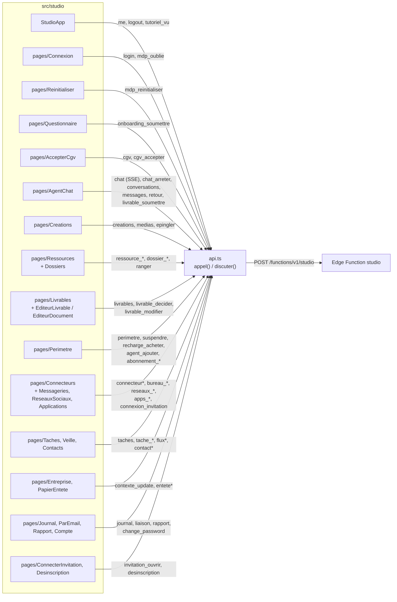
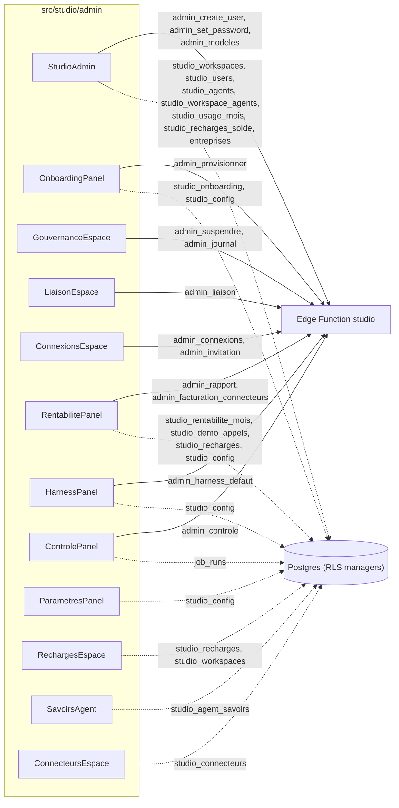
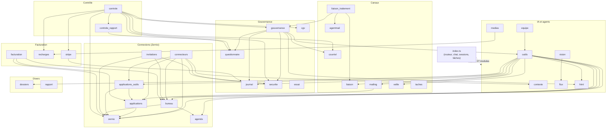
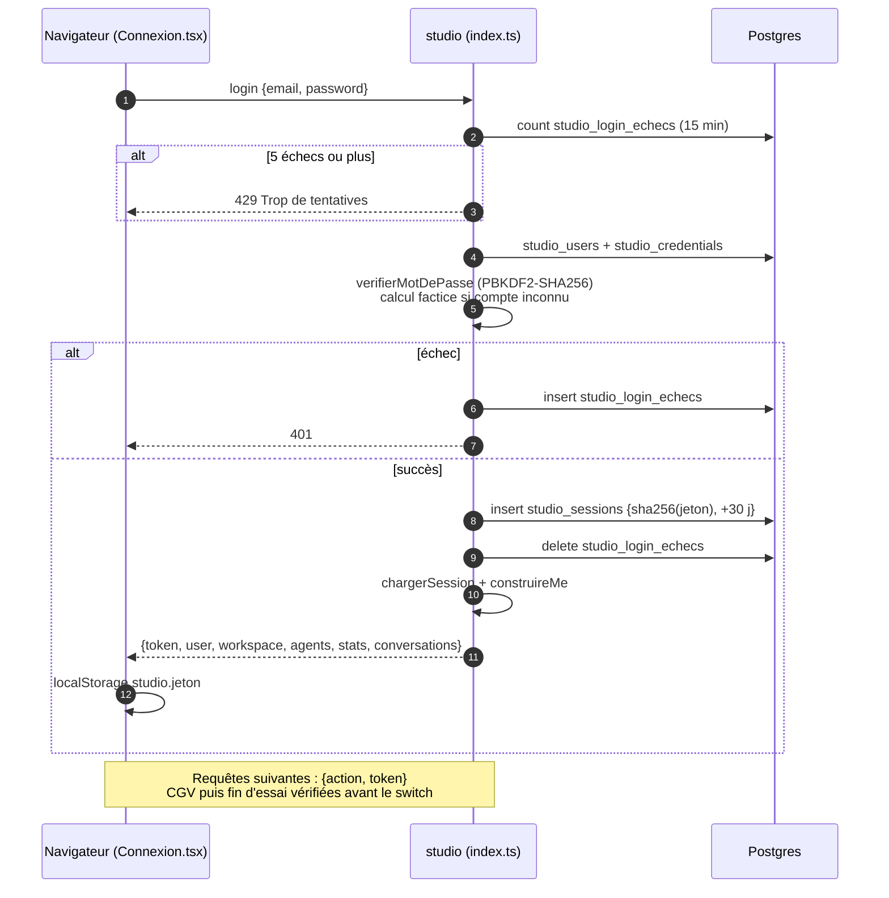
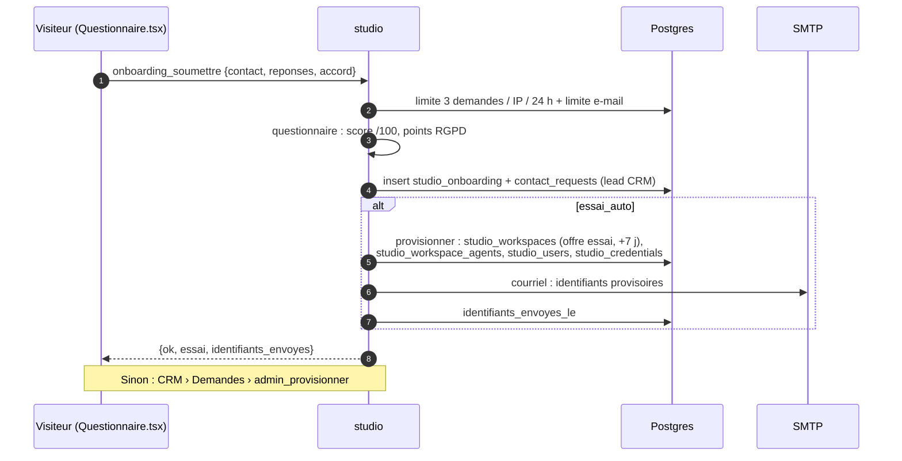
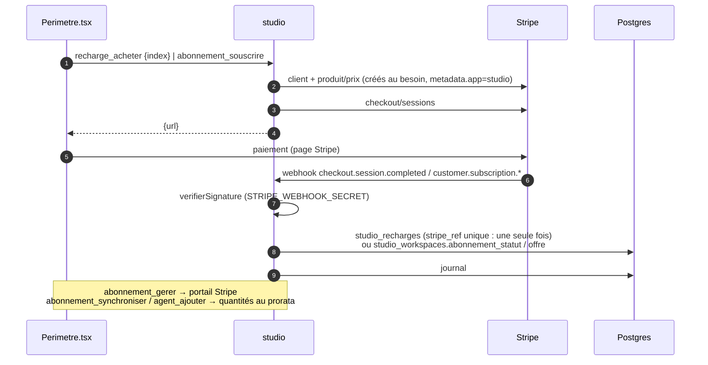
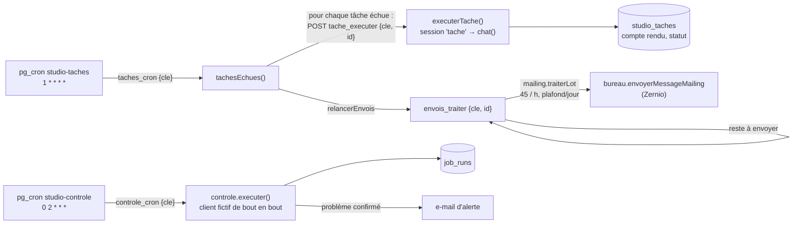
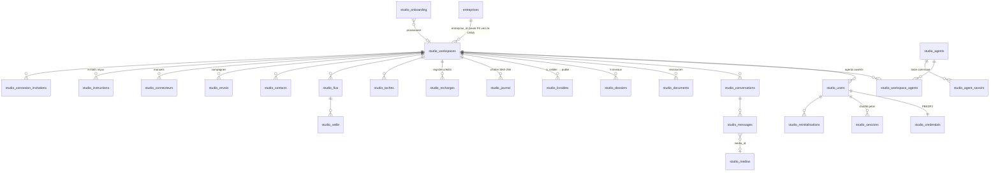

# Module Studio IA : appels et dépendances

> Analyse du code au 18/11/2026 (commit `51c3167`). Complète [`src/studio/README.md`](../src/studio/README.md), qui décrit les règles métier ; ce document décrit **qui appelle quoi**.
> Les graphes sont en Mermaid : ils s'affichent dans GitHub, VS Code (extension Markdown Preview Mermaid) ou tout lecteur Markdown compatible.

## Sommaire
1. [Vue d'ensemble](#1-vue-densemble)
2. [Points d'entrée de l'Edge Function](#2-points-dentrée-de-ledge-function-studio)
3. [Catalogue des actions](#3-catalogue-des-actions)
4. [Front client : pages → actions](#4-front-client--pages--actions)
5. [Admin CRM : actions et accès directs](#5-admin-crm--actions-et-accès-directs)
6. [Dépendances entre modules serveur](#6-dépendances-entre-modules-serveur)
7. [Flux détaillés (séquences)](#7-flux-détaillés)
8. [Données : tables, vues, RPC, stockage](#8-données)
9. [Services externes et secrets](#9-services-externes-et-secrets)
10. [Points d'attention](#10-points-dattention)

---

## 1. Vue d'ensemble

Tout le Studio passe par **une seule Edge Function, `studio`** (`verify_jwt = false`), qui joue cinq rôles selon la requête reçue : API client, API admin, récepteur de webhooks (Stripe, AgentMail), cible des tâches pg_cron et page publique (questionnaire, invitations, désinscription). Une seconde fonction, **`studio-demo`**, porte l'agent commercial « Sam » du site public ; elle est indépendante.



**Trois modes d'authentification coexistent dans la même fonction :**

| Appelant | Preuve d'identité | Vérification |
|---|---|---|
| Client Studio | `token` opaque dans le corps (64 hex, 30 jours) | `chargerSession` : SHA-256 du jeton → `studio_sessions` → `studio_users` → `studio_workspaces` |
| Manager CRM | JWT Supabase dans `Authorization` | `estManager` : `auth.getUser` puis RPC `is_manager` |
| pg_cron | `cle` dans le corps | comparaison à temps constant avec `studio_cron_cle` |
| Stripe | en-tête `Stripe-Signature` | HMAC avec `STRIPE_WEBHOOK_SECRET` |
| AgentMail | en-têtes `svix-id/timestamp/signature` | HMAC Svix avec `AGENTMAIL_WEBHOOK_SECRET` (+ `_PRECEDENT`) |
| Public | aucune | limites par IP / e-mail, jetons à usage unique |

---

## 2. Points d'entrée de l'Edge Function `studio`

`Deno.serve` (`index.ts:1165`) applique les filtres **dans cet ordre** ; le premier qui correspond répond.



Les missions (chat, médias) passent en plus par `gouvernance.garde()` : refus si l'espace est **suspendu** ou si le **plafond IA du jour** est atteint.

---

## 3. Catalogue des actions

Toutes les actions sont des `POST` JSON `{ action, token?, ... }` sur `/functions/v1/studio`. Sauf mention, la réponse est du JSON ; `chat` renvoie un flux SSE.

### 3.1 Publiques (sans session)

| Action | Rôle | Modules appelés |
|---|---|---|
| `login` | E-mail + mot de passe → jeton + `me` ; 5 échecs / 15 min | `securite` |
| `mdp_oublie` | Lien de réinitialisation (toujours `ok`, 3 / h / compte) | `securite`, `courriel` |
| `mdp_reinitialiser` | Nouveau mot de passe, ferme toutes les sessions | `securite`, `journal` |
| `onboarding_soumettre` | Questionnaire `/studio/demarrer` → demande + lead + essai auto | `gouvernance`, `questionnaire`, `essai`, `courriel` |
| `tarif_public` | Prix des connecteurs pour `/agents-ia` | `facturation` |
| `invitation_ouvrir` | Lien « connectez votre application » → URL Zernio | `invitations`, `bureau`, `zernio` |
| `desinscription` | Désinscription d'un contact de mailing | `index` |

### 3.2 Client (session obligatoire)

| Domaine | Actions | Modules serveur |
|---|---|---|
| **Compte** | `me`, `logout`, `change_password`, `cgv`, `cgv_accepter`, `tutoriel_vu` | `securite`, `cgv` |
| **Chat** | `chat` (SSE), `chat_arreter`, `conversations`, `messages`, `conversation_delete`, `retour`, `epingler`, `creations` | `contexte`, `outils`, `equipe`, `flux`, `vision`, `medias`, `recharges`, `gouvernance` |
| **Médias** | `media_statut`, `medias` | `medias` |
| **Ressources & dossiers** | `ressources`, `ressource_get`, `ressource_add`, `ressource_toggle`, `ressource_delete`, `dossiers`, `dossier_creer`, `dossier_renommer`, `dossier_deplacer`, `dossier_supprimer`, `ranger` | `dossiers` |
| **Entreprise** | `contexte_update`, `entete`, `entete_update`, `entete_logo` | Storage `studio-medias` |
| **Messageries / agenda / fichiers** | `bureau_etat`, `bureau_connecter`, `bureau_deconnecter`, `drive_choisir`, `connexion_invitation` | `bureau`, `zernio`, `invitations` |
| **Réseaux sociaux** | `reseaux_etat`, `reseaux_connecter`, `reseaux_deconnecter` | `zernio` |
| **Applications** | `apps_etat`, `apps_connecter`, `apps_deconnecter` | `applications`, `zernio` |
| **Connecteurs manuels** | `connecteurs`, `connecteur_enregistrer`, `connecteur_supprimer` | `connecteurs`, `securite` (chiffrement) |
| **Gouvernance** | `perimetre`, `suspendre`, `journal`, `livrables`, `livrable_soumettre`, `livrable_decider`, `livrable_modifier`, `liaison` | `gouvernance`, `journal`, `outils.executerAction` |
| **Facturation** | `recharge_acheter`, `abonnement_souscrire`, `abonnement_gerer`, `abonnement_synchroniser`, `agent_ajouter` | `recharges`, `stripe`, `facturation` |
| **Tâches planifiées** | `taches`, `tache_enregistrer`, `tache_supprimer`, `tache_lancer` | `taches` |
| **Veille** | `flux`, `flux_ajouter`, `flux_basculer`, `flux_supprimer`, `flux_actualiser` | `veille` |
| **Contacts & mailing** | `contacts`, `contact_ajouter`, `contacts_importer`, `contact_supprimer`, `contact_desinscrire` | `mailing` |
| **Rapport** | `rapport` | `rapport` |

### 3.3 Admin CRM (JWT manager)

| Action | Rôle |
|---|---|
| `admin_create_user`, `admin_set_password` | Créer un accès / réinitialiser un mot de passe provisoire |
| `admin_provisionner` | Créer l'espace depuis une demande d'onboarding |
| `admin_suspendre`, `admin_journal` | Arrêt d'urgence ; journal + vérification de la chaîne SHA-256 |
| `admin_modeles` | Catalogue OpenRouter (prix, constructeurs) |
| `admin_harness_defaut` | Consigne système par défaut des agents |
| `admin_rapport` | Rapport mensuel de valeur d'un client |
| `admin_connexions`, `admin_invitation` | État Zernio d'un espace ; lien d'invitation par e-mail |
| `admin_facturation_connecteurs` | Connecteurs facturables par espace |
| `admin_liaison` | Créer / activer / couper la boîte AgentMail |
| `admin_controle` | Lancer le contrôle du parcours client à la demande |

### 3.4 Internes (pg_cron, clé `studio_cron_cle`)

| Action | Déclencheur | Effet |
|---|---|---|
| `taches_cron` | pg_cron `studio-taches`, `1 * * * *` | Repère les tâches échues → un `tache_executer` par tâche ; relance les campagnes de mailing |
| `tache_executer` | `taches_cron` (auto-appel HTTP) | Exécute une tâche comme une mission chat (session `tache`) |
| `envois_traiter` | `taches_cron` / `mailing.declencherEnvois` | Un lot de mailing (45 / h, plafond quotidien par fournisseur), se relance jusqu'à épuisement |
| `controle_cron` | pg_cron `studio-controle`, `0 2 * * *` | Parcours client fictif de bout en bout, alerte e-mail, `job_runs` |

---

## 4. Front client : pages → actions

Le front n'importe rien du CRM (`@/…`). Il passe uniquement par `src/studio/api.ts` : `appel(action, données)` pour le JSON et `discuter()` pour le flux SSE du chat. Le jeton vit dans `localStorage['studio.jeton']` ; un 401 l'efface et lève `SessionExpiree`.



**Modules purs côté navigateur** (aucun appel réseau, sauf chargement de bibliothèques depuis esm.sh) :

| Fichier | Rôle |
|---|---|
| `extraction.ts` | Texte des pièces jointes (PDF, Word, Excel, PowerPoint, ODF, CSV) |
| `exportDoc.ts` / `exports.ts` | Markdown → `.docx` (docx@9.5.1 via esm.sh) et PDF (impression d'un cadre caché) ; `exports.ts` appelle `entete` |
| `htmlSur.ts` | Nettoyage HTML avant affichage, impression, export |
| `blocs.ts`, `rapport.ts`, `journal.ts`, `csvContacts.ts` | Mise en forme et analyse pures, testées |

---

## 5. Admin CRM : actions et accès directs

L'admin (`src/studio/admin/`) est la seule partie qui importe le CRM (`@/lib/supabase`, `@/components/ui`). Il mélange deux voies : **les actions sensibles passent par la fonction** (mots de passe, Zernio, Stripe, AgentMail, OpenRouter), **le reste lit et écrit directement les tables** sous la RLS managers.



---

## 6. Dépendances entre modules serveur

`supabase/functions/studio/` : 33 fichiers hors tests. `index.ts` (≈ 2 000 lignes) importe 27 des 32 autres modules. Le graphe ci-dessous omet les arêtes `index.ts → *` pour rester lisible et montre les dépendances **entre** modules.



**Lecture du graphe :**
- **`zernio.ts`** est la brique la plus partagée (7 modules en dépendent) : tout ce qui touche un compte tiers du client passe par lui.
- **`outils.ts`** (≈ 1 070 lignes) est le second pivot : il assemble les 31 outils proposés au modèle et `executerAction`, qui exécute un livrable validé.
- **`gouvernance.ts` → `outils.ts`** : la décision sur un livrable (`VALIDÉ`) exécute l'action portée par ce livrable.
- **Modules feuilles** (aucune dépendance interne) : `agenda`, `agentmail`, `cgv`, `contexte`, `courriel`, `dossiers`, `essai`, `flux`, `html`, `journal`, `liaison`, `questionnaire`, `rapport`, `recharges`, `securite`, `taches`, `veille`, `zernio`. La plupart sont purs et testés (`*.test.ts`).
- **`controle.ts`** dépend de presque tout le parcours : il rejoue le vrai chemin client.

### Outils exposés aux agents (`outils.ts`, `applications_outils.ts`, `equipe.ts`)

| Famille | Outils | Condition |
|---|---|---|
| Toujours | `ressource_lire`, `competence_enregistrer`, `note_enregistrer`, `dossiers_lister`, `ranger`, `document_rediger`, `document_lire`, `document_modifier`, `web_lire_page` | — |
| Messagerie | `mail_rechercher`, `mail_lire`, `mail_proposer_envoi` | boîte Zernio zone `email` |
| Agenda | `agenda_lister`, `agenda_proposer_rdv` | zone `calendar` |
| Fichiers | `fichiers_rechercher`, `fichiers_lister`, `fichiers_lire`, `fichiers_creer_document` | zone `files` (Drive / OneDrive) |
| Réseaux | `reseaux_publications`, `reseaux_commentaires`, `reseaux_messages`, `reseaux_statistiques`, `reseaux_proposer_publication`, `reseaux_proposer_reponse_commentaire`, `reseaux_proposer_message` | compte réseau connecté |
| Veille & mailing | `veille_actualites`, `veille_lire_article`, `veille_ajouter_flux`, `blog_proposer_article`, `contacts_listes`, `mailing_proposer` | — |
| Applications | outils `app_*` générés (blog Shopify/WordPress/Wix/Webflow, CRM HubSpot/Salesforce, YouTube, WhatsApp, Google Analytics, régies publicitaires) | application reliée |
| Équipe | `consulter_collegue` (3 par demande au plus) | au moins un autre agent ouvert |

Règle commune : **lecture = exécutée tout de suite et tracée ; écriture = `*_proposer_*` → livrable « à valider »**, exécuté par `outils.executerAction` au « VALIDÉ » du propriétaire.

---

## 7. Flux détaillés

### 7.1 Connexion et session



### 7.2 Mission dans le chat (`chat`, flux SSE)

C'est le flux le plus riche : il mobilise quotas, gouvernance, contexte, outils, collègues et comptabilité.

```mermaid
sequenceDiagram
  autonumber
  participant N as AgentChat.tsx (discuter)
  participant F as studio · chat()
  participant DB as Postgres
  participant OR as OpenRouter
  participant T as outils / Zernio

  N->>F: chat {agent_id, message | pouvoir, conversation_id?, pieces?}
  F->>DB: agents de l'espace (agent ouvert ?)
  F->>DB: compterDemandesMois
  opt quota du mois atteint
    F->>DB: recharges.couvrable (sinon 429 recharge:true)
  end
  F->>DB: gouvernance.garde (suspendu ? plafond IA du jour ?)
  F->>DB: parametres.ai (clé, modèles)
  opt images jointes
    F->>OR: vision.decrireImage (model_vision)
  end
  F->>DB: reprise ou création studio_conversations
  alt super-pouvoir média (image / vidéo)
    F->>OR: medias.lancerMedia
    F->>DB: studio_medias, studio_messages, journal
    F-->>N: JSON {media:{id, statut:en_cours}}
    N->>F: media_statut {id} (sondage)
  else mission texte
    par contexte
      F->>DB: 12 derniers messages
      F->>DB: rpc studio_recherche_docs (4) + 8 docs récents
      F->>DB: contenus épinglés (6), connecteurs, harness, en-tête
      F->>DB: rpc studio_recherche_savoirs (8 000 car.)
    end
    F->>DB: insert message client
    F->>T: outilsEspace (définitions selon connexions)
    F-->>N: event meta {conversation_id, ressources, savoirs}
    loop jusqu'à 7 tours
      F->>OR: chat/completions stream:true (+ tools)
      OR-->>F: fragments delta / tool_calls / usage
      F-->>N: event delta {text}
      opt appels d'outils (5 par tour au plus)
        alt consulter_collegue
          F->>OR: collègue, sans outils, sans flux
        else autre outil
          F->>T: outils.executer (lecture) ou livrable à valider (écriture)
        end
        F-->>N: event outil {libelle} / document {id, titre}
      end
    end
    F->>DB: insererReponse (coût USD, tokens, modèle)
    F-->>N: event done {message_id}
    F->>DB: journaliser mission ; hors_quota si [[RELAIS:…]]
  end
  Note over F: EdgeRuntime.waitUntil : la génération continue si l'onglet se ferme.<br/>chat_arreter pose arret_demande, relu toutes les 2 s.
```

### 7.3 Onboarding et essai gratuit



### 7.4 Paiement Stripe (recharge et abonnement)



### 7.5 Canal e-mail de liaison (AgentMail)

```mermaid
sequenceDiagram
  autonumber
  participant U as Utilisateur (e-mail)
  participant AM as AgentMail
  participant F as studio
  participant L as liaison_traitement
  participant DB as Postgres

  U->>AM: « [Hugo] objet » vers la boîte de l'espace
  AM->>F: webhook message.received (svix-*)
  F->>F: verifierSvix
  F-->>AM: 200 immédiat
  F->>L: traiterMail (waitUntil)
  L->>DB: dédoublonnage event_id, 30 messages / h / espace
  L->>L: expéditeur autorisé + SPF/DKIM/DMARC ; détection fraude au président
  alt commande du propriétaire
    L->>DB: VALIDÉ / REFUSÉ L-…, SUSPENDRE, REPRENDRE
  else mission
    L->>F: executeurMail → même chemin que chat()
    L->>DB: studio_instructions INSTR-AAAA-NNNN, livrable « à valider »
    L->>AM: réponse dans le fil (Auto-Submitted)
  end
```

### 7.6 Tâches planifiées et mailing



Chaque tâche tourne **dans sa propre instance** (appel HTTP à soi-même) pour ne pas buter sur la limite de 150 s des Edge Functions.

---

## 8. Données

### 8.1 Modèle simplifié



### 8.2 Inventaire

| Catégorie | Objets |
|---|---|
| **Identité** | `studio_workspaces`, `studio_users`, `studio_credentials` (aucune politique RLS), `studio_sessions`, `studio_login_echecs`, `studio_reinitialisations` |
| **Agents** | `studio_agents`, `studio_workspace_agents`, `studio_agent_savoirs`, `studio_config` (harness, CGV, quotas par défaut, destinataires du contrôle) |
| **Conversations** | `studio_conversations`, `studio_messages`, `studio_medias` |
| **Contenus** | `studio_documents`, `studio_dossiers`, `studio_livrables` |
| **Gouvernance** | `studio_onboarding`, `studio_journal`, `studio_instructions` |
| **Connexions** | `studio_connecteurs`, `studio_connexion_invitations`, `studio_nango_connexions` *(abandonnée)* |
| **Automatisation** | `studio_taches`, `studio_cron_cle`, `studio_flux`, `studio_veille`, `studio_contacts`, `studio_envois` |
| **Facturation** | `studio_recharges` |
| **Démo** | `studio_demo_appels` |
| **Vues** | `studio_usage_mois`, `studio_rentabilite_mois`, `studio_recharges_solde` |
| **RPC** | `studio_recherche_docs`, `studio_recherche_savoirs` (service role), `studio_controle_crons`, `is_manager` |
| **Tables CRM touchées** | `parametres` (clé `ai`, SMTP), `contact_requests` (leads), `job_runs` ; `studio-demo` écrit aussi `contacts`, `opportunites` |
| **Storage** | bucket privé `studio-medias` (logos, images, vidéos ; URL signées 1 h) |

Tables les plus sollicitées par le code serveur : `studio_workspaces` (39 requêtes), `studio_livrables` (22), `studio_documents` (17), `studio_messages` (16), `studio_users` (15).

---

## 9. Services externes et secrets

| Service | Usage | Modules | Secrets |
|---|---|---|---|
| **OpenRouter** | Chat en flux, consultation de collègue, vision, images (`meta/muse-image`), vidéos (`minimax/hailuo-3-max`), catalogue de modèles | `index`, `vision`, `medias`, `studio-demo` | `OPENROUTER_API_KEY` (sinon `parametres.ai.openrouter_key`) |
| **Zernio** | Profils par espace ; Gmail/Outlook/IMAP, agendas, Drive/OneDrive ; réseaux sociaux ; applications | `zernio`, `bureau`, `applications*`, `invitations`, `facturation` | `ZERNIO_API_KEY` |
| **Stripe** | Checkout (recharges), abonnements, portail, webhook | `stripe` | `STRIPE_SECRET_KEY`, `STRIPE_WEBHOOK_SECRET` |
| **AgentMail** | Boîte de liaison par espace, webhook Svix, réponses | `agentmail`, `liaison*` | `AGENTMAIL_API_KEY`, `AGENTMAIL_WEBHOOK_SECRET`, `AGENTMAIL_WEBHOOK_SECRET_PRECEDENT` |
| **SMTP** | Identifiants, réinitialisation, alertes du contrôle | `courriel` | `SMTP_HOST/PORT/USERNAME/PASSWORD/FROM`, `STUDIO_SMTP_FROM/USERNAME/PASSWORD` |
| **Web public** | `web_lire_page`, flux RSS de veille (anti-SSRF, 2 Mo, 10 s) | `veille` | — |
| **esm.sh** (navigateur) | `docx`, extracteurs PDF/Office chargés à la demande | `exports.ts`, `extraction.ts` | — |
| **Supabase** | Base, stockage, auth des managers | tous | `SUPABASE_URL`, `SUPABASE_SERVICE_ROLE_KEY`, `SUPABASE_ANON_KEY` |
| **Chiffrement local** | Secrets des connecteurs manuels | `securite` | `STUDIO_CLE_CHIFFREMENT` |

---

## 10. Points d'attention

Constats issus de la lecture du code (aucun n'a été corrigé ici) :

1. **`index.ts` concentre tout** : ≈ 2 000 lignes, routeur, sessions, `chat()` (≈ 375 lignes), tâches, admin. Toute évolution du chat ou d'une action client touche ce fichier. Extraire `chat()` et `admin()` dans leurs modules réduirait le risque de conflit (cf. commits Bolt qui écrasent `main`).
2. **Ordre des filtres signifiant** : la désinscription (`?desinscription=`) passe avant toute vérification ; les webhooks sont reconnus **à la présence d'un en-tête**. C'est voulu, mais une nouvelle route publique doit être insérée avant `chargerSession`, et une nouvelle action « après essai » ajoutée à `ACTIONS_APRES_ESSAI` (`essai.ts`), sinon elle répondra 402.
3. **Webhook AgentMail** : `verifierSvix` est appelé avant le test « secrets absents » ; sans secret, la réponse reste un 503 correct, mais l'ordre peut surprendre à la relecture.
4. **Commentaire d'en-tête incomplet** (`index.ts:10-55`) : il ne liste ni les actions Zernio réseaux/applications, ni Stripe, ni dossiers, ni `mdp_*`, `cgv`, `tutoriel_vu`. Le [catalogue §3](#3-catalogue-des-actions) est à jour.
5. **Reliquats Nango** : la table `studio_nango_connexions` et la migration `20261116100000_studio_nango.sql` ne servent plus (README).
6. **Admin en double voie** : certaines écritures admin (quotas, recharges, savoirs, paramètres) passent directement par les tables sous RLS managers, donc hors de `journaliser()` : elles n'apparaissent dans `studio_journal` que si un déclencheur SQL le fait (non vérifié ici). Les actions passant par la fonction, elles, sont journalisées.
7. **Prix dupliqués** : paliers 149 → 74,50 € présents dans `stripe.ts`, `studio-demo/index.ts`, `src/site/pages/AgentsIA.tsx` et `scripts/prerender.mjs`, à garder alignés à la main.
8. **Deux fonctions déployées séparément** : `studio` et `studio-demo` ne se déploient pas par un push (redéploiement via le MCP Supabase).
